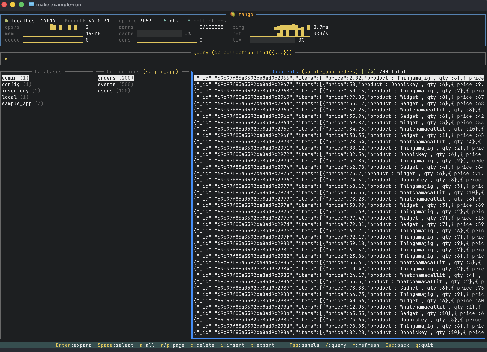

# 🥭 tango

A k9s-inspired TUI for MongoDB. Browse databases, query collections, manage documents — all from your terminal.

 

## Install

```sh
go install github.com/mrecachinas/tango/cmd/tango@latest
```

Or build from source:

```sh
git clone https://github.com/mrecachinas/tango.git
cd tango
make build
```

## Usage

```sh
tango --mongo-host localhost --mongo-port 27017

# With auth
tango -u admin -p secret --mongo-host db.example.com

# With connection profile
tango --profile staging

# Password via env var (recommended)
TANGO_MONGO_PASSWORD=secret tango -u admin
```

## Layout



## Keybindings

| Key | Action |
|-----|--------|
| `Tab` / `Shift+Tab` | Cycle panels |
| `/` | Focus query bar |
| `:` | Command palette |
| `?` | Help overlay |
| `Enter` | Select / expand document |
| `Esc` | Go back |
| `n` / `p` | Next / previous page |
| `t` | Toggle JSON / tree view |
| `d` | Delete document |
| `e` | Edit in $EDITOR |
| `i` | Insert new document |
| `c` | Copy to clipboard |
| `x` | Export JSON |
| `C` | Export CSV |
| `s` | Sort documents |
| `Space` | Toggle selection |
| `I` | View indexes |
| `S` | Server stats |
| `L` | Toggle live mode |
| `r` / `R` | Refresh / full refresh |
| `q` | Quit |

## Query Bar

Supports full MongoDB shell syntax:

```
db.users.find({age: {$gt: 25}})
db.orders.findOne({status: "shipped"})
db.events.aggregate([{$group: {_id: "$type", count: {$sum: 1}}}])
db.users.distinct("role")
db.logs.count({level: "error"})
```

Relaxed JSON — unquoted keys, `$` operators, single quotes all work.

## Command Palette

Press `:` to enter command mode:

| Command | Action |
|---------|--------|
| `:indexes` | View collection indexes |
| `:stats` | Server stats (currentOp, slow queries, top collections) |
| `:sort <field>` | Sort by field (prefix with `-` for descending) |
| `:limit <n>` | Change page size |
| `:export json/csv` | Export current results |
| `:use <db>` | Switch database |
| `:watch <interval>` | Live mode with custom interval (e.g. `:watch 5s`) |
| `:refresh` | Reload current view |

## Connection Profiles

Create `~/.tango.yaml`:

```yaml
profiles:
  local:
    mongo_url: localhost
    mongo_port: 27017
  staging:
    mongo_url: staging.example.com
    mongo_port: 27017
    mongo_user: readonly
    mongo_password: secret
    mongo_db: myapp
```

Then: `tango --profile staging`

## Example Environment

```sh
make example-run    # starts MongoDB in Docker, seeds data, launches tango
make example-down   # tear down
```

## License

MIT
