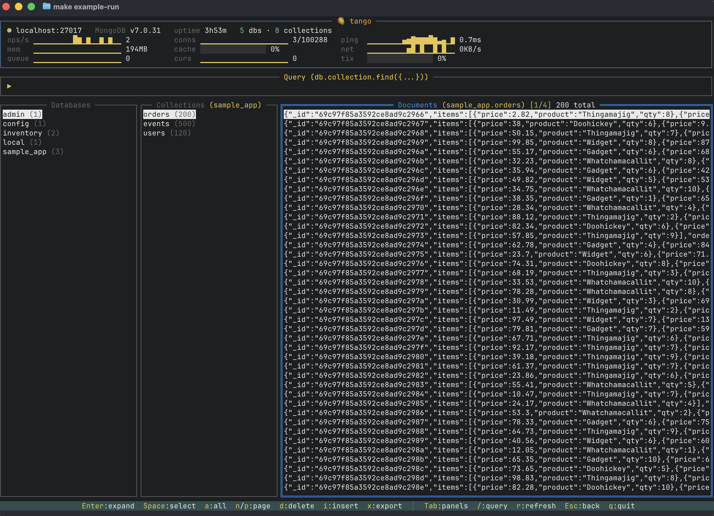
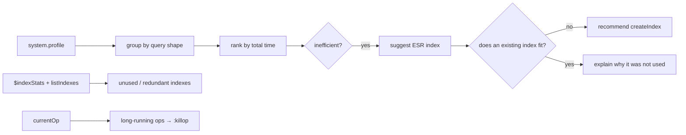

# 🥭 tango

A k9s-inspired TUI for MongoDB. Browse databases, query collections, manage documents — all from your terminal.
Built with Bubble Tea v2, Lip Gloss v2 and Bubbles v2.

 



## Features

- Database › collection sidebar with fuzzy filtering and lazy-loaded collections.
- Document tables or syntax-highlighted JSON rows, with pagination and multi-selection.
- Collapsible document trees and searchable JSON detail, preserving BSON types.
- MongoDB shell-style queries, autocomplete/history, sorting and JSON/CSV exports.
- Fuzzy command palette, filterable help and guarded edit/insert/delete/drop actions.
- Live watch and server stats: active operations, top collections and slow queries.
- Query analysis: `:explain` shows which index a query uses and what index would help;
  `:insights` ranks slow query shapes, hot collections, and missing, unused or redundant indexes.
- One-line metrics header with sparklines (`M` expands it), plus a mode pill and contextual hints in the footer.
- Responsive sidebar (`W` toggles it), configurable skins and `NO_COLOR` support.

## Install

```sh
go install github.com/mrecachinas/tango/cmd/tango@latest
```

Or build from source:

```sh
git clone https://github.com/mrecachinas/tango.git
cd tango
make build
```

Or open the repo in a [dev container](https://containers.dev) (VS Code, Codespaces).
It ships Go, `golangci-lint`, and Docker-in-Docker, so `make test-e2e` and
`make example-run` work inside the container.

## Usage

```sh
tango --mongo-host localhost --mongo-port 27017
tango --uri 'mongodb+srv://cluster0.example.net/?authSource=admin' -u admin   # prompts for password
tango -u admin --auth-source admin --mongo-host db.example.com
tango --profile staging                          # connection profile (~/.tango.yaml)
TANGO_MONGO_PASSWORD=secret tango -u admin       # password via env var
```

Settings resolve as flag > environment (`TANGO_MONGO_URI`, `TANGO_MONGO_PASSWORD`) > profile.
Profiles accept `uri`, `mongo_url`, `mongo_port`, `mongo_user`, `mongo_password`, `mongo_db`,
`auth_source` and `refresh_rate` (seconds between metrics refreshes; also `--refresh-rate`).

### Theming

The Bubble Tea interface uses the terminal's background, thin focused panes, and
a compact header/footer. Put a global `theme:` block in `~/.tango.yaml` (or
override it inside a connection profile):

```yaml
theme:
  name: dark # dark (default), light, mono, or auto
  colors:
    accent: "#89b4fa"
    border: "238"
profiles:
  local:
    uri: mongodb://localhost:27017
```

`colors` accepts hex colors or ANSI color numbers for `text`, `muted`, `faint`,
`border`, `accent`, `onaccent`, `cursor`, `select`, `match`, `onmatch`, `ok`, `warn`,
`err`, `info`, `key`, `string`, `number`, `bool`, `null`, `helper`, and `punct`.
`auto` chooses dark/light from the detected terminal background; `mono` uses
terminal defaults. A non-empty `NO_COLOR` forces monochrome, ignoring overrides.
Profile theme settings inherit global colors and override individual tokens.
The sidebar hides automatically below 90 columns;
`W` can still show it, and `Tab` reveals it when moving focus back to databases.

## Querying

The query bar takes a filter for the current collection (`{age: {$gt: 30}}`) or mongo-shell
calls: `find` (with `.sort()`, `.limit()`, `.skip()`, `.projection()`), `findOne`,
`countDocuments`, `estimatedDocumentCount`, `distinct` and `aggregate` (including `$out`/`$merge`).
Shell helpers such as `ObjectId("…")`, `ISODate("…")`, `NumberLong(…)`, `NumberDecimal("…")`,
`UUID("…")` and `/regex/i` are supported.

Documents are shown, copied and edited in the same shell syntax, so editing preserves BSON types
(int32/int64/double, dates, ObjectIds, …) and field order exactly.

## Query analysis

### Explain

`:explain` (or `E` in the document list) explains the query on screen: the current
filter, sort, projection and page, or the last shell query. It also accepts a query or a
filter, and an optional verbosity (`queryPlanner`, `executionStats` (default) or
`allPlansExecution`):

```text
:explain db.orders.find({cust: "c4"}).sort({created: -1})
:explain queryPlanner {status: "open"}
db.orders.find({cust: "c4"}).explain()            # shell forms work in the query bar too
db.orders.explain("allPlansExecution").aggregate([{$match: {cust: "c4"}}])
```

`find`, `findOne`, `count*`, `distinct`, `aggregate`, `update*`, `replaceOne` and
`delete*` can be explained. Writes are explained, not executed. The report leads with
findings: collection scans, in-memory sorts and disk spills, unbounded index scans,
filters applied after fetching, poor examined:returned ratios, `$lookup` join strategies,
and runs that hit the time limit. It then summarises the winning plan. When
an index would help, it suggests one ordered by the ESR rule (equality, sort, range)
and states whether an existing index already fits. The raw explain output follows.

### Insights

`:insights [db]` (`:advisor`) is a PlanetScale Insights-style overview of one database,
built from the profiler, `$indexStats`, `$collStats`, `top` and `currentOp`:

- **Recommendations:** indexes to add (with `createIndex` commands), slow or
  JavaScript-heavy queries, long-running operations to `:killop`, and unused or redundant
  indexes to `hideIndex`.
- **Slow query shapes:** profiled operations grouped by normalised shape (`Q1`, `Q2`, …)
  and ranked by total time. `:explain Q2`, or `E` in this view, re-explains a shape.
- **Hot collections, index usage and running operations.**



Query shapes need the profiler. If it is off, insights suggests
`db.setProfilingLevel(1, {slowms: 50})`. Index usage counters are per node and reset on
restart, so unused-index advice suggests hiding the index before dropping it.

## Keybindings

Shortcuts are case-sensitive and apply outside inputs/overlays. Inputs capture
printable shortcut keys; `Ctrl+c` always quits.

### Navigation

| Key | Action |
|-----|--------|
| `Tab` / `Shift+Tab` | Cycle sidebar ↔ content |
| `j` / `k`, `↓` / `↑` | Move down/up or scroll detail/help |
| `g` / `G`, `Home` / `End` | First/last row or start/end of detail/help |
| `Ctrl+d` / `Ctrl+u` | Half-page down/up |
| `PageDown` / `PageUp` | Full-page down/up |
| `l` / `→` (sidebar) | Expand database / open collection |
| `h` / `←` (sidebar) | Parent database / collapse database |
| `/` or typing (sidebar) | Fuzzy filter; reserved shortcuts still work until filtering starts |
| `Enter` (sidebar filter) | Finish filtering and open the selected result |
| `Backspace` / `Ctrl+h` (sidebar filter) | Remove a filter character |
| `Esc` | Clear sidebar filter; otherwise go back / return to sidebar |
| `I` (sidebar collection) | Show indexes |
| `D` (sidebar) | Drop selected collection or database (type its name to confirm) |
| `Enter` / `X` (indexes) | Show index detail / drop selected index (y/N) |

### Documents

| Key | Action |
|-----|--------|
| `/` (list) | Query bar: filter or MongoDB shell syntax |
| `Enter` (list) | Open document tree |
| `v` (list) | Toggle table / JSON rows |
| `h` / `l`, `←` / `→` (list) | Scroll table columns or JSON rows horizontally |
| `0` / `$` (list) | First/last column or horizontal start/end of JSON rows |
| `n` / `p` (list) | Next/previous document page |
| `s` (list) | Prefilled sort prompt |
| `Space` (list) | Toggle selection and advance |
| `a` / `A` (list) | Select all on page / clear selection |
| `d` (list) | Delete selected documents or cursor document (y/N) |
| `e` / `i` (list or detail) | Edit / insert via `$VISUAL`, `$EDITOR` or `vi` |
| `x` / `C` (list) | Export selection or current page as JSON / CSV |
| `E` (list) | Explain the current query or page |
| `t` (detail) | Toggle JSON / tree |
| `c` (detail) | Copy document to clipboard |
| `/` (detail) | Search JSON; from tree, switches to JSON first |
| `n` / `N` (JSON detail) | Next/previous search match |
| `Enter` / `Space` (tree) | Toggle selected node |
| `l` / `→`, `h` / `←` (tree) | Expand/child, collapse/parent |
| `E` / `C` (tree) | Expand all / collapse all (root stays open) |

### Global

| Key | Action |
|-----|--------|
| `:` | Fuzzy command palette |
| `?` | Open/close filterable help |
| `r` / `R` | Refresh data (or focused stats) / full refresh |
| `W` | Toggle sidebar; hidden means full-width content |
| `M` | Toggle expanded metrics header |
| `S` | Server stats |
| `L` | Toggle live watch (auto-refresh) |
| `q` / `Ctrl+c` | Quit (`Ctrl+c` also works in inputs/overlays) |

### Commands

| Key / context | Action |
|---------------|--------|
| Type (palette) | Fuzzy-match commands, actions, databases and collections, or enter a raw command |
| `↓` / `↑`, `Ctrl+n` / `Ctrl+p` (palette/help) | Choose next/previous item or scroll help |
| `Enter` / `Esc` (palette or prompt) | Submit / cancel |
| `Tab` / `Shift+Tab` (query/command prompt) | Cycle autocomplete forward/backward |
| `↑` / `↓` (query/command prompt) | Browse query/command history |
| `/` or typing (help) | Filter keys and descriptions; `Enter` leaves filter mode |
| `Esc` (help) | Clear filter first, then close |
| `y` (y/N confirmation) | Confirm; any other key cancels |
| Type exact name + `Enter` (database/collection drop) | Confirm; `Esc` cancels |

#### Command palette commands

Press `:` and choose a fuzzy match or enter a raw command, e.g. `:sort ts -1`.
Choices needing arguments open a command prompt.

| Command | Action |
|---------|--------|
| `:db name` (`:database`, `:use`) | Select database; without a name, focus sidebar |
| `:dbs` (`:databases`) | Focus database sidebar |
| `:coll name` (`:collection`) | Select collection in current database; without a name, focus sidebar |
| `:colls` (`:collections`) | Focus sidebar for current database |
| `:indexes` (`:idx`) | List indexes of current collection |
| `:stats` (`:profile`) | Show server stats |
| `:explain [verbosity] [query\|{filter}\|Qn]` | Explain the current page, a query, a filter or an insights shape |
| `:insights [db]` (`:advisor`) | Slow query shapes, hot collections and index recommendations |
| `:sort field -other` or `:sort field -1` | Sort ascending/descending; bare `:sort` clears sort |
| `:limit n` | Set page size (1–10,000); bare `:limit` shows current size |
| `:export json\|csv [all] [path]` | Export selection/page, or stream all matching documents with `all` |
| `:watch [interval]` | Toggle live watch; with e.g. `2s`, start/restart at that interval (minimum `500ms`) |
| `:killop opid` | Confirm killing an operation listed in stats |
| `:refresh` / `:refresh!` | Refresh / full refresh |
| `:drop database` | Drop selected/current database after typing its exact name |
| `:q` (`:quit`) | Quit |

Database/collection drops cannot be undone. Index drops, document deletes and
operation kills use lowercase `y` confirmation instead.

## Try It

```sh
make example-run    # starts MongoDB in Docker, seeds data, launches tango
make example-down   # tear down
```

## Tests

```sh
make test       # unit tests
make test-e2e   # drives the root model against a throwaway MongoDB in Docker
```

The end-to-end suite pumps Bubble Tea commands and `ApplyMsg` closures directly,
without a terminal, and is skipped unless `TANGO_E2E_MONGO_URI` is set.
`make test-e2e` requires Docker; replica-set initialization runs `mongosh` inside
the `mongo:7` container, so no host `mongosh` installation is needed.

To use an existing replica set instead of starting Docker:

```sh
TANGO_E2E_MONGO_URI='mongodb://localhost:27017/?replicaSet=rs0' \
  go test -race -count=1 ./internal/e2e/
```

Use a development/test replica set: the suite creates and drops uniquely named
test databases and exercises writes and administrative operations.

## License

MIT
